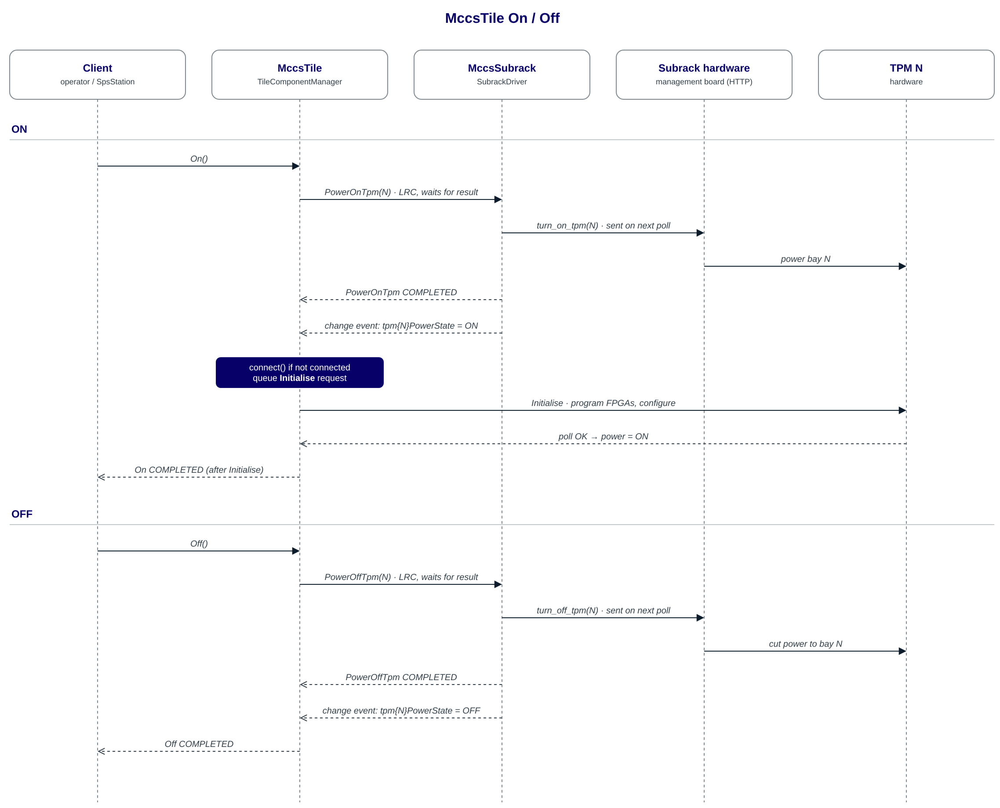
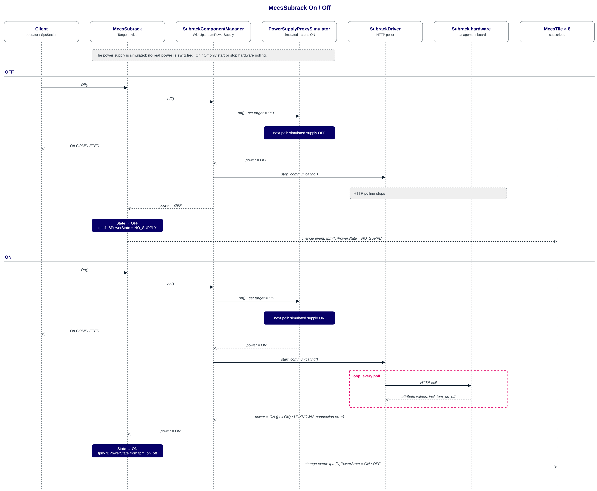
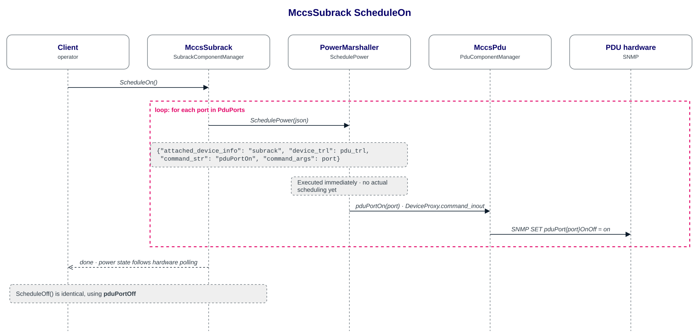
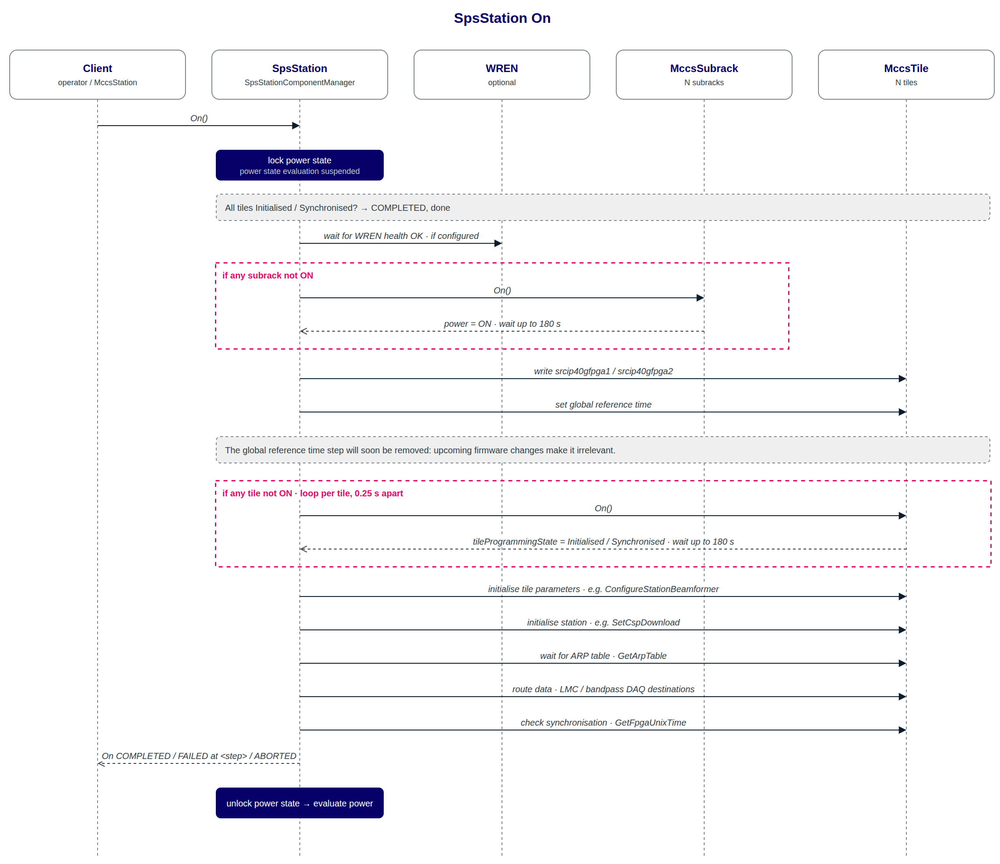
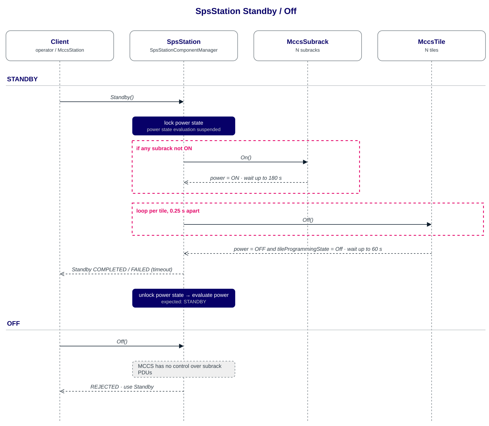

Power Distribution
==================

The Monitor, Control and Calibration System covers power management for the SKA Low Frequency Aperture Array (LFAA). This includes both operational commands such as On/Off and monitoring ability for different voltages and power use. Because of the nature of the LFAA and the hierarchical nature of MCCS devices, the power management commands can be quite a bit more complex than one might expect at first glance. 

Hardware Overview
-----------------

In order to properly cover this topic it's important to get an overview of the hardware. At the core of the LFAA we have the (dual polarized) RF Antenna, each containing a pair of Low Noise Amplifiers (LNAs). Each LNA is connected by coaxial cable to a Smartbox. This serves to power the LNA and carry the RF signals. Each Smartbox serves up to 12 antennas and is in turn connected to a Field Node Distribution Hub (FNDH). This device provides power downstream and aggregates the signal upstream. These sets of devices are grouped together in what is called a SKA-Low station, each containing 256 antennas, 24 smartboxes and 1 FNDH. In MCCS this hardware is controlled by the Power and Signal Distribution (PaSD) system.

All the data from the antennas is sent to the Tile Processing Modules (TPM). Each Tile processes the signal from 16 antennas, and an entire FieldStation has its output covered by 16 TPMs. The Subrack supplies power to 8 TPMs, and in turn it has its power supplied by the PDU.

To sum everything up, the LFAA components are supplied with power through FNDH (for all the antenna related hardware) and PDU + Subracks (for the signal processing).

This hardware comprises what is called a Field Node or Station. The LFAA will be composed of roughly ~500 such Stations. MCCS aggregates all of them under the Controller device which has the role of assigning resources for observations.

Software Overview
-----------------

MCCS is composed of MCCS Tango Devices. These are self contained programs that control portions of the telescope. Some of these Tango Devices are directly responsible for hardware components, such as the Tile, Subrack, Smartbox, and so on. Other devices work to aggregate these devices, like the SpsStation and the FieldStation (both aggregating the devices in a SKA-Low Station for their respective system). Both of these devices are in turn controlled by the MccsStation, and all such stations are then controlled by the MccsController. At this point we should note that there are other Tango Devices in MCCS that are purely virtual. And so, we find three broad groups of Tango Devices in MCCS:

- hardware-facing devices
- aggregate devices
- virtual devices

The first set implement power commands by sending commands to hardware to turn on/off, communicating with the devices that supply power to them to confirm the current draw, and to directly report measurements from the device.

The second group implement power commands by communicating with their subdevices. They schedule on/off commands and report the power state based on the subdevice's power.

The last group often don't implement power command, and if they have a power state it is simply "On".

MCCS has no tango devices for the Individual Antenna, as their states are reflected in the SmartBox ports.

.. note::

    MCCS is a distributed system composed of microservices hosted on Kubernetes. In practice this means that the Hardware MCCS controls lives separate than the Server that hosts MCCS (at least from a power management perspective). MCCS doesn't control the power distribution to the servers hosting it. All the power commands in MCCS control power on the LFAA.

Power Mode Implementation
^^^^^^^^^^^^^^^^^^^^^^^^^

In MCCS, each Tango device's component manager tracks the power state of the component it controls, and the device reflects it in its Tango ``State`` attribute. The device also implements Tango commands to change between those states. Power states are defined by the ``PowerState`` enum from ``ska_control_model``, which has the following values:

- ON: The component is powered on and running in fully-operational mode.
- OFF: The component is turned off but can be commanded on.
- STANDBY: The component is powered on and running in low-power standby mode.
- UNKNOWN: The power mode is not known.
- NO_SUPPLY: The component is unsupplied with power and cannot be commanded on.

For example, the power mode of a TPM will be ``NO_SUPPLY`` if the subrack that powers the TPM is turned off: not only is the TPM off, but it cannot even be turned on (until the subrack has been turned on).

Every device starts with its power state ``UNKNOWN``. While the device is offline (``adminMode`` ``OFFLINE``) its Tango ``State`` is ``DISABLE``. When it is put online (``adminMode`` ``ONLINE`` or ``ENGINEERING``), its component manager starts communicating with the hardware or subdevices it controls. The power state stays ``UNKNOWN`` until communication is established. After that, the component manager reports the power state whenever it changes, and the device updates its ``State`` to match.

To change the power state, each device has a command named after the state it drives the device to: ``On()``, ``Off()`` and ``Standby()``. For example, ``device.On()`` asks the device to go to ``PowerState.ON``. These are long-running commands: the call returns straight away with a command ID, and the result is reported when the command finishes. Not every device implements all three (see the device sections below).

The ``On``/``Off``/``Standby`` commands do different things depending on the hardware or subdevices they control.

SPS Devices
-----------

All of the Tango Devices in SPSHW have a Power State and a set of commands to turn the device on or off. How the device determines its power state depends on its role, and the commands are also highly dependent on the device. This section will cover each device and their peculiarities.

MccsTile
^^^^^^^^

The **Power state:** of a tile is influenced by the subrack that the tile is connected too. The tile polls the hardware for information periodically and as part of this process, if the poll succeeds, it sets the PowerState to ON. If a poll to the TPM fails, it defaults to the power state value reported by the subrack, a mismatch between the two (TPM reachable but subrack says not ``ON``, or subrack says ``ON`` but TPM unreachable) is marked by the fault flag.

The power commands of tile are implemented as follows:

- ``On``: calls ``PowerOnTpm(N)`` on the subrack, then queues an ``Initialise`` request. The command only completes once initialisation finishes. When the subrack reports the TPM as ``ON`` and the TPM is not yet initialised, the tile starts initialising it without being asked.
- ``Off``: calls ``PowerOffTpm(N)`` on the subrack.

MccsSubrack
^^^^^^^^^^^

Two device classes can serve the Tango class ``MccsSubrack``. The
``MCCS_SUBRACK_IMPLEMENTATION`` environment variable of the device server
selects one. With ``legacy``, or with the variable not set, the server runs the
legacy ``ska_low_mccs_spshw.subrack.MccsSubrack``. With ``prototype``, it runs
``MccsPrototypeSubrack``, which switches the PDU ports that feed the subrack.
This section describes the legacy device.

The **Power state** of the legacy subrack is set by polling the subrack
management board (SMB) over HTTP. A successful poll means ``ON``. A poll that
gets no answer from the board means ``UNKNOWN``. The device does not read the
PDU, so a subrack whose PDU ports are off reports ``UNKNOWN``, not ``OFF``.

The subrack also publishes a ``tpm{N}PowerState`` value for each bay. It is
``ON`` or ``OFF`` from the board's ``tpm_on_off`` reading. Every bay is
``NO_SUPPLY`` while the subrack is ``OFF``, and ``UNKNOWN`` while the subrack
is ``UNKNOWN`` or communication is lost. The board values are read every
``UpdateRate`` seconds (15 s by default), and straight after a board command
finishes.

The legacy subrack has a power supply layer between the device and the board.
That layer is a ``PowerSupplyProxySimulator`` that starts ``ON``. It stands in
for the PDU, and it switches no real power. The ``On`` and ``Off`` commands act
only on that simulated supply.

- ``On`` sets the simulated supply to ``ON`` at its next poll. The device then
  starts polling the board again, and goes ``ON`` after the first successful
  poll. ``On`` does not switch the PDU, so it cannot power up a subrack that has
  no power.
- ``Off`` sets the simulated supply to ``OFF`` at its next poll. The device
  stops polling the board, clears its hardware attributes, reports ``OFF``,
  and sets every ``tpm{N}PowerState`` to ``NO_SUPPLY``. The board and its TPMs
  stay powered. A tile whose TPM still answers keeps reporting ``ON``, and
  flags the mismatch with the subrack as a fault.
- ``Standby`` is not implemented and raises ``NotImplementedError``.

The TPM commands queue a request that the poller sends to the board on its next
poll. The poller sends one board command at a time. When the board runs a
command asynchronously, the poller asks ``command_completed`` on each poll
until the command finishes. The command then reports ``COMPLETED``, or
``FAILED`` if the board reports a failure. A later request for the same bay,
or for all bays, replaces a request that has not been sent yet, and the
replaced request reports ``ABORTED``.

- ``PowerOnTpm(N)`` and ``PowerOffTpm(N)`` send ``turn_on_tpm`` or
  ``turn_off_tpm`` for bay ``N`` (one-based). ``MccsTile`` calls these from its
  own ``On`` and ``Off``.
- ``PowerUpTpms`` and ``PowerDownTpms`` send ``turn_on_tpms`` or
  ``turn_off_tpms`` for every bay.

The legacy subrack also has commands that act on the PDU. The ``PduTrl`` and
``PduPorts`` device properties name the ``MccsPdu`` device and the ports that
feed the subrack. ``SimulatedPDU`` is ``True`` by default, and then the device
does not connect to the PDU at all.

- ``PowerPduPortOn(port)`` and ``PowerPduPortOff(port)`` are meant to switch one
  PDU port directly. With ``SimulatedPDU`` set, or with no ``PduTrl``, they do
  nothing and report ``OK``.
- ``ScheduleOn`` and ``ScheduleOff`` send one ``SchedulePower`` request to the
  ``PowerMarshaller`` named by ``PowerMarshallerTrl`` for each port in
  ``PduPorts``, to run ``pduPortOn`` or ``pduPortOff`` on the PDU. With no
  ``PowerMarshallerTrl``, they log a warning and do nothing.

.. warning::

  ``PowerPduPortOn`` and ``PowerPduPortOff`` do not switch the port when a PDU
  is configured. ``pduPort{N}OnOff`` is an attribute of ``MccsPdu``, not a
  command, so the call fails and the command reports ``FAILED``. Use
  ``pduPortOn`` and ``pduPortOff`` on ``MccsPdu`` instead. ``ScheduleOn`` and
  ``ScheduleOff`` never report a result, so they stay ``QUEUED`` even after the
  requests are sent.

  
   The subrack is under redesign and the power command structure will be simplified in the future.

MccsPdu
^^^^^^^

The role of the PDU device is to supply the subracks with power. To do this, it inherits functionality from the SNMP Component Manager: https://developer.skao.int/projects/ska-ser-snmp/en/latest/?badge=latest, and adds a connection to the Power Marshaller. 

Individual outlets are switched with ``pduPortOn(port)``/ ``pduPortOff(port)``, which write the ``pduPort{N}OnOff`` SNMP attribute. 

The **Power State** is ``ON`` whenever an hardware poll succeeds, ``UNKNOWN`` when a poll fails. It is effectively a measure of whether communication is working.

- ``On``/``Off``/``Standby``: not implemented and will raise ``NotImplementedError``

PowerMarshaller
^^^^^^^^^^^^^^^

.. note:: 
  The PowerMarshaller is currently implemented only as a stand in, and there are future plans to extend its functionality and it will be responsible for scheduling power operations to take account of load change rates and phase balancing. See https://confluence.skatelescope.org/display/SE/SP-4250+Power+control+proposal for further information.

**Power state:** a purely virtual device. It is ``ON`` as soon as communication is established.

- ``On``/``Off``/``Standby``: not implemented.
- ``SchedulePower`` takes a device TRL, a command name and an argument and runs that command on the target device (for example ``pduPortOn`` on a PDU). At the moment it runs the command straight away; nothing is actually scheduled yet.

SpsStation
^^^^^^^^^^

SpsStation is a virtual device that mostly aggregates all other tango devices in a SKA-Low station. As such, **Power state:** is determined from the power states of its subracks and tiles:

#. Any tile ``ON`` → ``ON``
#. Any subrack ``ON`` and all tiles ``OFF``/``NO_SUPPLY`` → ``STANDBY``
#. All subracks and tiles ``NO_SUPPLY`` → ``NO_SUPPLY``
#. All subracks and tiles ``OFF``/``NO_SUPPLY`` → ``OFF``
#. Otherwise → ``UNKNOWN``

The WREN power state is logged but not used.

- ``On``: does nothing if all tiles are already initialised or synchronised. Otherwise it waits for the WREN (if one is configured), turns on the subracks, sets the tile source IPs and the global reference time, and turns on the tiles 0.25 s apart. It then initialises the tiles and the station, waits for the ARP table, routes data and checks synchronisation.
- ``Standby``: makes sure the subracks are ``ON``, then turns the tiles off 0.25 s apart and waits (up to 60 s) for every tile to report ``OFF``.
- ``Off``: sends ``Off`` to every subrack and waits for each result. A
  prototype subrack switches off its PDU ports, which also removes power from
  its TPMs. The station goes ``OFF`` when the subrack and tile power states
  report it. A legacy subrack only stops polling its board, so its TPMs stay
  powered and the station does not go ``OFF``.

  The global reference time step will soon be removed, as upcoming firmware changes make it irrelevant.

